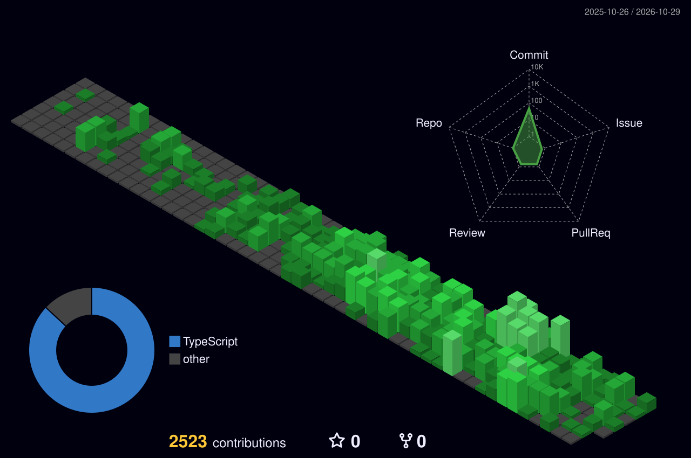

<h1 align="center">Angelo Ortiz Vega</h1>
<h3 align="center">Technical Lead, Implementations · <a href="https://www.silia.com/">Silia</a></h3>
 

  I own the technical side of getting AI agents from signed deal to stable production — 
  with client IT teams, implementers, and the platform team on the same page.

  
  &nbsp;
  
  &nbsp;
  

---
 
## What I Own
 
- **The technical solution for Implementations** — I sign off estimates, decide when an AI agent is ready to go live, and define the hypercare window for each release.
- **Client IT relationships** — I'm the technical counterpart on integrations, access, infrastructure, and security.
- **Team flow** — I unblock implementers when they hit a platform limit, distribute technical work across the team, and escalate diagnoses (not symptoms) to the platform team.
## How I Work
 
- **Feasibility is tested, not debated.** Before answering "can we do this?", I stand up a test agent and verify it end to end.
- **Every PoC and demo is scoped in writing** — what it shows, what it doesn't, and what is simulated — so it never becomes an unplanned commitment.
- **Escalations come with evidence.** When something goes to the platform team, it arrives with a reproduction and a likely cause.
## Reach Out To Me For
 
- Effort estimates and go-live readiness for an implementation
- Integration, access, infrastructure, or security questions from a client's IT team
- "Is this possible on the platform?" — I'll come back with a tested answer
- Scoping a PoC or demo before it's promised to a client
## Tech Stack
 
| Area | Tools |
|---|---|
| **Languages** | Python, TypeScript, JavaScript, PHP, SQL |
| **Backend & APIs** | Node.js, FastAPI, REST API design, service orchestration |
| **Frontend** | React, Ember.js, component-driven interfaces |
| **Data & AI** | LLM agents, ML pipelines, prompt and context orchestration |
| **Databases & Infra** | PostgreSQL, Docker, AWS, production deployment and monitoring |
 
---

  

